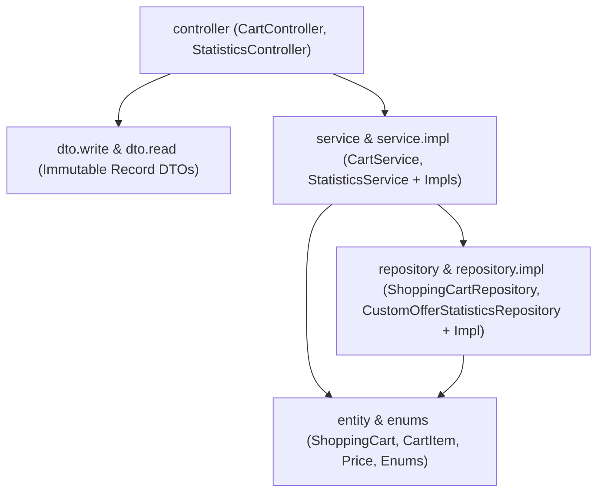
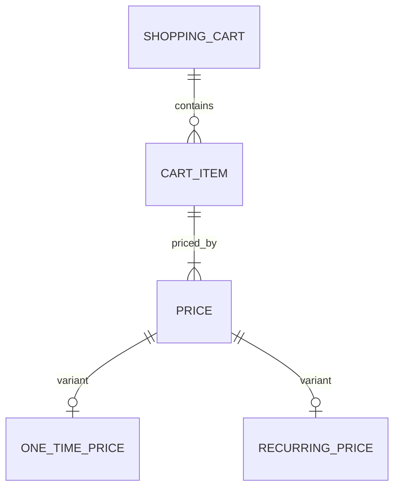

# Architecture Spine — Shopping Cart Microservice

## Design Paradigm

**Pragmatic Layered Architecture with Rich Entities** under base package `com.retailsystem.cart`:
- `controller`: Inbound HTTP controllers (`CartController`, `StatisticsController`).
- `dto.write` & `dto.read`: Separated **Write Models (`dto.write`)** and **Read Models (`dto.read`)**.
- `service` & `service.impl`: Service interfaces (`CartService`, `StatisticsService`) in `service` and implementations (`CartServiceImpl`, `StatisticsServiceImpl`) in `service.impl`.
- `entity`: Rich domain entities (`ShoppingCart` `@Document`, `CartItem`, and sealed `Price` value objects `OneTimePrice` and `RecurringPrice`) that encapsulate business invariants without duplicate model/document mapper boilerplate.
- `enums`: Dedicated package for domain enums (`ItemAction`, `RecurrenceUnit`, `CartStatus`).
- `repository` & `repository.impl`: Spring Data MongoDB repository (`ShoppingCartRepository`) and custom statistics repository interface (`CustomOfferStatisticsRepository`) in `repository`, with the `MongoTemplate` aggregation implementation (`CustomOfferStatisticsRepositoryImpl`) in `repository.impl`.
- `exception`: Domain exceptions and `GlobalExceptionHandler` (`ProblemDetail`).
- `config`: MongoDB index and `Decimal128` converter configuration (`MongoConfig`).



## Invariants & Rules

### AD-1 — Rich Entities Without Duplicate Model/Document Bloat `[ADOPTED]`

- **Binds:** `FR-1`, `FR-2`, `FR-3`, `FR-4`, `FR-5`, `FR-6`
- **Prevents:** Anemic entities that allow invalid state in memory, as well as over-engineered duplicate `DomainModel` + `MongoDocument` + `Mapper` boilerplate.
- **Rule:** Persist rich entities directly from `com.retailsystem.cart.entity` (`ShoppingCart`, `CartItem`, `Price`, `OneTimePrice`, `RecurringPrice`) and place all enums (`ItemAction`, `RecurrenceUnit`, `CartStatus`) in `com.retailsystem.cart.enums`. Enforce all `BR1` and `BR2` invariants (`offerId` non-blank, `prices.size >= 1`, `Price.value > 0`, `RecurringPrice.recurrences > 0`, non-null enums) inside entity constructors/methods throwing `DomainValidationException`.

### AD-2 — Separated Write and Read DTO Models `[ADOPTED]`

- **Binds:** `FR-1`, `FR-2`, `FR-3`, `FR-5`, `FR-7`, `NFR-4`
- **Prevents:** Reusing mutable or shared DTOs across inbound write commands and outbound read queries, or exposing entity persistence internals over HTTP.
- **Rule:** Inbound request payloads must use immutable Java `record` types in `dto.write` (`AddCartItemRequest`, sealed `PriceWriteDto` with `OneTimePriceWriteDto` and `RecurringPriceWriteDto` discriminated by `type`). Outbound responses must use immutable Java `record` types in `dto.read` (`ShoppingCartResponse`, `CartItemResponse`, sealed `PriceReadDto`, `OfferStatisticsResponse`).

### AD-3 — Interface-Driven Service and Repository Boundaries (`service/impl` & `repository/impl`) `[ADOPTED]`

- **Binds:** `all`
- **Prevents:** Controllers coupling to concrete service implementations or mixing interface contracts with implementation classes.
- **Rule:** Service interfaces (`CartService`, `StatisticsService`) reside in `service` with implementations in `service.impl`. Repository interfaces (`ShoppingCartRepository`, `CustomOfferStatisticsRepository`) reside in `repository` with custom aggregation query implementations in `repository.impl`.

### AD-4 — Dual Query Strategy (Simple Derived ORM vs. Complex Aggregation) `[ADOPTED]`

- **Binds:** `FR-1`, `FR-2`, `FR-3`, `FR-4`, `FR-5`, `FR-7`, `NFR-1`
- **Prevents:** Hand-writing verbose boilerplate queries for simple CRUD lookups, or loading cart documents into JVM memory to filter/count statistics.
- **Rule:** Simple single-cart queries use descriptive Spring Data repository interface methods (`findByCustomerIdAndStatus(String customerId, CartStatus status)`). Analytical queries (`FR-7`) execute inside MongoDB via `CustomOfferStatisticsRepositoryImpl` using `MongoTemplate` aggregation pipeline (`$match` -> `$unwind` -> `$match` -> `$group` -> `$project` with `$setDifference` to compute `soldCount`, `activeCartCount`, `evictedCartCount`, `totalAddedCount`, and `retargetingCustomerIds`).

### AD-5 — Single-Collection Cart Lifecycle & Index Contract `[ADOPTED]`

- **Binds:** `FR-1`, `FR-4`, `FR-5`, `FR-7`, `NFR-1`, `NFR-2`, `NFR-3`
- **Prevents:** Race conditions creating multiple `ACTIVE` carts for one customer, floating-point precision loss on prices, or unindexed collection scans on statistics queries.
- **Rule:** Persist all cart states (`ACTIVE`, `CHECKED_OUT`, `EVICTED`) in the `shopping_carts` collection with:
  1. Partial unique index on `{ "customerId": 1 }` with `partialFilterExpression: { "status": "ACTIVE" }`.
  2. Compound index on `{ "items.offerId": 1, "items.action": 1, "items.addedAt": 1, "status": 1 }`.
  3. `@Version Long version` on `ShoppingCart` for optimistic locking.
  4. Custom `BigDecimal <-> Decimal128` Mongo converters for all monetary values.

### AD-6 — Zero AI Comments & Pragmatic Testing Discipline (`unit` & `integration`) `[ADOPTED]`

- **Binds:** `all`
- **Prevents:** Comment clutter in source/test files and brittle/bloated test suites.
- **Rule:** Source and test `.java` files must contain zero explanatory inline comments, unfinished task markers, or redundant Javadocs. Unit tests in `src/test/java/com/retailsystem/cart/unit` cover entity invariants (`Price`, `CartItem`, `ShoppingCart`) without Spring context startup; integration tests in `src/test/java/com/retailsystem/cart/integration` use Testcontainers (`@ServiceConnection` with MongoDB) to verify end-to-end API and aggregation flows.

## Consistency Conventions

| Concern | Convention |
| --- | --- |
| Naming (entities, files, interfaces, events) | Entities use domain nouns in `entity` (`ShoppingCart`, `CartItem`); enums live in `enums`; interfaces live in `service`/`repository` with implementations suffixed `Impl` in `service.impl`/`repository.impl`. |
| Data & formats (ids, dates, error shapes, envelopes) | IDs (`cartId`, `itemId`) are UUID strings; timestamps are UTC ISO-8601 `Instant`; monetary values are `BigDecimal` (`Decimal128` in Mongo); errors use RFC 9457 `application/problem+json` (`ProblemDetail`). |
| State & cross-cutting (mutation, errors, logging, config, auth) | `DomainValidationException` -> `400 Bad Request`; `ResourceNotFoundException` -> `404 Not Found`; `InvalidCartStateException` / `OptimisticLockingFailureException` -> `409 Conflict`. |

## Stack

| Name | Version |
| --- | --- |
| Java (OpenJDK Temurin) | `26` (`25 LTS` compatible) |
| Spring Boot | `4.1.2` |
| Maven (with `mvnw`) | `3.9.x` |
| MongoDB | `8.0` (Docker / Testcontainers) |
| Testcontainers | Managed via Spring Boot `4.1.2` BOM |

## Structural Seed



```text
retail-system/
  pom.xml
  docker-compose.yml
  src/
    main/java/com/retailsystem/cart/
      ShoppingCartApplication.java
      config/
      controller/
      dto/
        read/
        write/
      entity/
      enums/
      exception/
      repository/
        impl/
      service/
        impl/
    test/java/com/retailsystem/cart/
      unit/
      integration/
```

## Capability → Architecture Map

| Capability / Area | Lives in | Governed by |
| --- | --- | --- |
| `FR-1`..`FR-5` Cart Lifecycle Operations | `controller.CartController`, `service.impl.CartServiceImpl`, `entity.ShoppingCart`, `repository.ShoppingCartRepository` | `AD-1`, `AD-2`, `AD-3`, `AD-4`, `AD-5` |
| `FR-6` Item & Polymorphic Price Invariants | `entity.CartItem`, `entity.Price`, `entity.OneTimePrice`, `entity.RecurringPrice`, `enums.*` | `AD-1`, `AD-2`, `AD-6` |
| `FR-7` Offer Sales & Retargeting Statistics | `controller.StatisticsController`, `service.impl.StatisticsServiceImpl`, `repository.impl.CustomOfferStatisticsRepositoryImpl` | `AD-2`, `AD-3`, `AD-4`, `AD-5` |

## Deferred

- **External Event Broker Integration (Kafka / RabbitMQ):** Publishing `CartCheckedOut` or `CartEvicted` events to external brokers is deferred until downstream Order Management or CRM microservices are introduced.
- **Authentication / OAuth2 Resource Server:** `customerId` is passed via path parameter in v1 per assignment scope; JWT subject extraction is deferred to API Gateway / v2.
